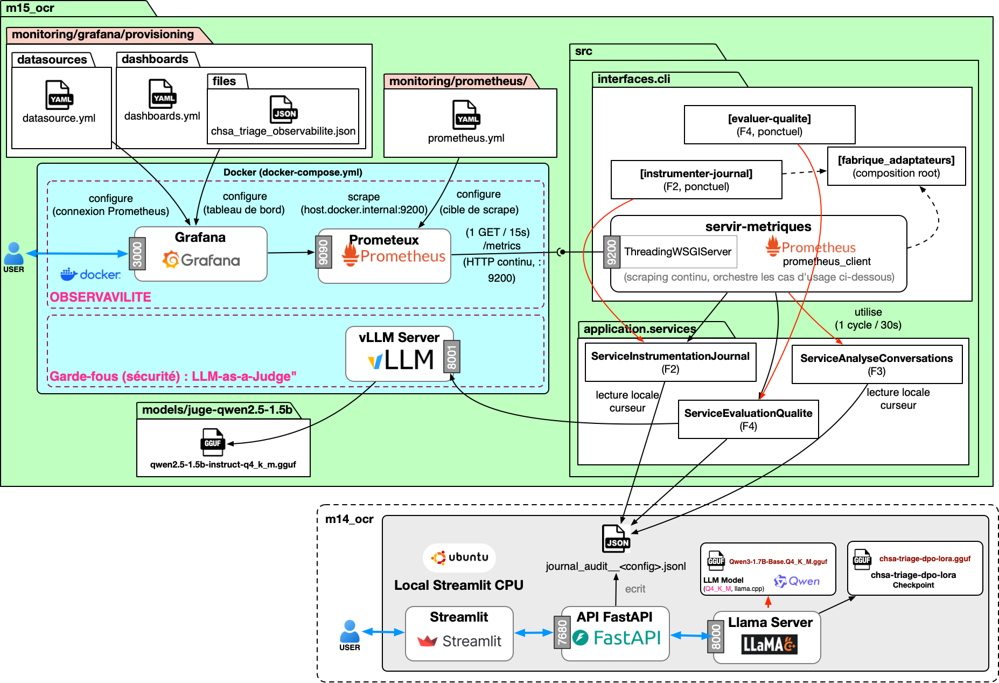

<p align="center"></p>

# CHSA Triage: Observabilité et Garde-fous (juge-LLM)


> Audit et instrumentation (Prometheus/Grafana) de l'agent de triage
> médical [CHSA (m14_ocr)](https://github.com/racemartin/m14_ocr),
> **sans modifier** le système audité.
> Architecture hexagonale (ports et adaptateurs), même discipline que
> m14_ocr.

## Pourquoi ce projet

Le code de m14_ocr documente lui-même, dans son propre port
`JournalAudit`, une décision de périmètre : *« jamais une stack
d'observabilité lourde »*. m15_ocr comble précisément ce manque, de
façon non invasive : le système audité ne change pas une seule ligne.

## Feuille de route et choix techniques

Résumé des chapitres 3-4 du rapport de conduite de projet (détail complet
dans le document) :

- **Pile retenue** : Prometheus + Grafana auto-hébergés (gratuit, aucune
  donnée transmise à un tiers) plutôt qu'un SaaS managé.
- **Garde-fou** : juge-LLM local et dédié plutôt qu'une API distante ou des
  règles/regex — exigence non négociable en contexte hospitalier (aucune
  donnée de diagnostic ne quitte la machine).
- **Modèle du juge** : `Qwen2.5-1.5B-Instruct` retenu après un premier essai
  (`Phi-3-mini-4k-instruct`) qui a dépassé 4 Go de RAM réelle sur
  l'environnement cible (plafond 6 Go) — décision sur preuve empirique, pas
  sur réputation.
- **Aucun conteneur pour le code Python** : seuls Prometheus et Grafana sont
  conteneurisés ; les services Python restent des processus hôte pour un
  accès direct au système de fichiers local.
- **Roadmap** : F0 → F1 → F2 → F3 → F5 livrés ; F4 (niveau ESI, instrumentation
  directe de l'API) reste le principal chantier non démarré.
- **Risque principal rencontré** : saturation mémoire (survenue trois fois),
  systématiquement mitigée par surveillance active et seuil d'abandon avant
  tout nouveau chargement de modèle.
- **Limite assumée** : le garde-fou est rétrospectif, jamais préventif — il
  ne peut pas bloquer une réponse avant qu'elle n'atteigne son destinataire.
- **Prochaine étape la plus urgente** : configurer un dépôt Git distant — le
  dépôt reste local à ce jour, aucun lien public n'existe encore.

## Architecture

Schéma complet (ports, adaptateurs, et relation avec m14_ocr) :
[`docs/00_architecture.md`](docs/00_architecture.md).

Vue d'ensemble des composants du dépôt — pile d'observabilité Docker
(Prometheus/Grafana), points d'entrée CLI, cas d'usage F0-F5, et leur
lien avec le système audité (m14_ocr) et le juge-LLM dédié :



> Schéma illustratif. Pour la version qui reflète exactement les noms
> actuels (`llama-server`, jamais `vLLM` ; `F5`, jamais `F4`), voir la
> version générée automatiquement :
> [`docs/diagrams/composants/diagramme_composants.svg`](docs/diagrams/composants/diagramme_composants.svg).

**Documents de référence :**
- Architecture complète (ports, adaptateurs, F0-F5, preuves en conditions réelles) : [`docs/00_architecture.md`](docs/00_architecture.md)
- Installation détaillée, variables d'environnement, discipline de sécurité : [`docs/01_installation.md`](docs/01_installation.md)
- Vue d'ensemble visuelle (résumée, 3 systèmes) : [`docs/diagrams/architecture_cible.svg`](docs/diagrams/architecture_cible.svg)
- Version détaillée du schéma (ports/adaptateurs complets) : [`docs/diagrams/architecture_hexagonale.svg`](docs/diagrams/architecture_hexagonale.svg)
- Carte complète des indicateurs du domaine (construits/dérivables/indisponibles) : [`docs/diagrams/mapa_metricas_triage.svg`](docs/diagrams/mapa_metricas_triage.svg)

---

## Démarrage rapide

```bash
git clone <url-du-depot> m15_ocr
cd m15_ocr

uv sync --group dev
cp .env.example .env
# Renseigner HF_TOKEN et, si disponibles, CHSA_TRIAGE_URL_SANTE / MLFLOW_TRACKING_URI

uv run verifier-environnement
```

Sortie attendue (si `.env` est vide, les vérifications sont simplement
ignorées, pas en échec) :

```
================================================================================
VÉRIFICATION DE L'ENVIRONNEMENT
================================================================================
  Aucune dépendance externe configurée dans .env pour l'instant.
================================================================================
Toutes les dépendances configurées sont accessibles.
```

Installation détaillée, variables d'environnement une par une, et
discipline de sécurité : [`docs/01_installation.md`](docs/01_installation.md).

## Tableau de bord (Prometheus + Grafana)

```bash
uv run servir-metriques &          # expose /metrics en continu sur l'hôte
docker compose up -d               # Prometheus (scrape) + Grafana (dashboard)
```

Grafana : [http://localhost:3000](http://localhost:3000) (`admin` /
`GRAFANA_ADMIN_PASSWORD`, `admin` par défaut). Détails de la pile et des
premiers panneaux : [`docs/00_architecture.md`](docs/00_architecture.md)
"Pile d'observabilité".

## Garde-fous (juge-LLM, F5)

`servir-metriques` fait aussi évaluer chaque diagnostic par un
juge-LLM LOCAL et DÉDIÉ (modèle distinct de celui audité, sécurité et
forme uniquement, jamais l'exactitude clinique). Il faut un second
`llama-server` séparé de celui de chsa-triage :

```bash
LD_LIBRARY_PATH=<dossier-llama.cpp> <dossier-llama.cpp>/llama-server \
    -m <modele-juge>.gguf --port 8001 -c 1024 -t 2 --no-webui --host 0.0.0.0

uv run evaluer-qualite      # ponctuel, ou déjà inclus dans servir-metriques
```

Détails (choix du modèle, discipline rétrospective-pas-préventive,
preuve en conditions réelles) : [`docs/00_architecture.md`](docs/00_architecture.md)
"F5 : garde-fous (juge-LLM, sécurité/forme)".

## Indicateurs disponibles

Inventaire complet des indicateurs du domaine (construits, dérivables sans
code nouveau, ou indisponibles), avec leur métrique Prometheus exacte et le
panneau Grafana correspondant. Détail complet : [`docs/00_architecture.md`](docs/00_architecture.md)
et [`docs/diagrams/mapa_metricas_triage.svg`](docs/diagrams/mapa_metricas_triage.svg).

| # | Indicateur | État | Source réelle | Qui la génère |
|---|---|---|---|---|
| R9 | Volume de requêtes | 🟢 Construit | `chsa_journal_entrees_total` | F2 — panneau n°1 |
| R1/D2 | Latence réponse / diagnostic (p50/p95) | 🟢 Construit | `chsa_journal_latence_secondes` | F2 — panneau n°2 |
| R10 | Taux d'échec d'inférence | 🟢 Construit | `chsa_journal_erreurs_total` | F2 — panneau n°3 |
| D1 | Respect du format de diagnostic | 🟢 Construit | `chsa_diagnostic_format_respecte_total` | F2 — panneau n°4 |
| C6 | Taux d'échec par conversation | 🟢 Construit | `chsa_conversation_avec_echec_total` | F3 — panneau n°5 |
| C1 | Nombre de tours avant diagnostic | 🟢 Construit | `chsa_conversation_nombre_tours` | F3 — panneau n°6 |
| R2/D3 | Tokens de sortie (p50/p95) | 🟢 Construit | `chsa_journal_tokens_sortie` | F2 — panneau n°7 |
| X2 | Coût estimé cumulé | 🟢 Construit | Formule Grafana sur `chsa_journal_tokens_sortie_sum` | Panneau n°8 |
| C2 | Temps jusqu'au diagnostic | 🟢 Construit | `chsa_conversation_temps_diagnostic_secondes` | F3 — panneau n°9 |
| C3 | Taux de reformulation | 🟢 Construit | `chsa_conversation_reformulation_total` | F3 — panneau n°10 |
| D8 | Score garde-fous (juge-LLM) | 🟢 Construit | `chsa_garde_fou_score` | F5 — panneau n°11 |
| D9 | Alertes garde-fous | 🟢 Construit | `chsa_garde_fou_alerte_total` | F5 — panneau n°12 |
| X1 | Comparaison entre configurations | 🟢 Construit | Étiquette `configuration` sur toute métrique | `by (configuration)` en PromQL |
| — | Longueur de conversation | 🟡 Dérivable | Regrouper `chsa_journal_entrees_total` par `conversation_id` | Agrégation à écrire dans F2 |
| R3 | Tokens par seconde | 🟡 Dérivable | PromQL pur (tokens/latence) | Panneau Grafana seul |
| R7 | Position du tour dans la conversation | 🟡 Dérivable | PromQL pur, `count()` | Panneau Grafana seul |
| X3 | Carte de chaleur de l'activité | 🟡 Dérivable | Série continue déjà disponible depuis `servir-metriques` | Panneau Grafana heatmap seul |
| C4 | Durée totale de conversation | 🟡 Écartée | Redondante avec C2 | Non retenue |
| R6 | Pertinence (RAGAS / juge) | 🔴 Indisponible | Job d'évaluation par lots jamais construit | Hors périmètre (≠ D8/D9) |
| C5 | Taux d'abandon | 🔴 Indisponible | Nécessite de détecter l'absence d'un événement futur | Fenêtre glissante à construire |
| C7 | Efficacité clinique du diagnostic | 🔴 Indisponible | Nécessiterait un référentiel médical de vérité terrain | Hors périmètre d'un POC |
| R4/R5 | Longueur/pertinence de la question | 🔴 Indisponible | Jamais consigné par le système existant | — |
| R8 | Dégénérescence / boucle | 🔴 Indisponible | Aucune détection construite | — |
| D4 | Niveau ESI | 🔴 Indisponible | Jamais persisté (réservé F4) | Instrumentation API, non démarrée |
| D5/D6 | Raisonnement / distribution ESI | 🔴 Indisponible | Dépend de D4 | — |
| D7 | Cas ESI urgents et latence | 🔴 Indisponible | Dépend de D4 | Nécessite F4 |
| X4 | Latence inférence pure vs HTTP totale | 🔴 Indisponible | Nécessiterait d'instrumenter le client HTTP | — |

## Tests et lint

```bash
uv run pytest -q
uv run ruff check src/
```

## Auteur

**Rafael Cerezo Martín**

- Email : [rafael.cerezo.martin@icloud.com](mailto:rafael.cerezo.martin@icloud.com)
- GitHub : [@racemartin](https://github.com/racemartin)


## Licence

MIT License, voir [LICENSE](LICENSE).
