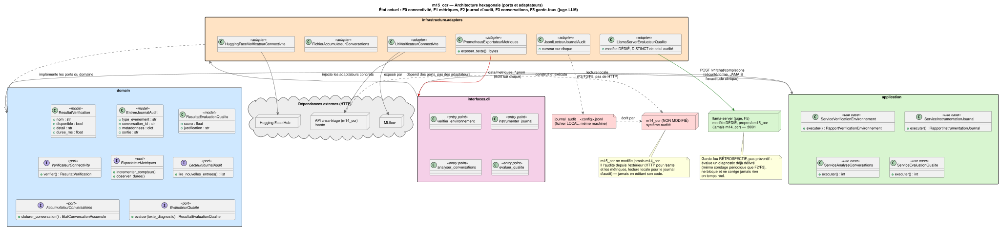

# Architecture

## Principe directeur

m15_ocr **audite et instrumente** l'agent de triage médical CHSA
(m14_ocr) **sans jamais le modifier**. Le paquet `chsa-triage` de
m14_ocr est installable directement depuis GitHub (déjà utilisé ainsi
dans ses propres jobs d'entraînement), ce qui permet à m15_ocr de s'y
connecter uniquement par des frontières externes (HTTP, dataset HF),
jamais en copiant ou en éditant son code.

## Architecture hexagonale (ports et adaptateurs)

Même discipline que m14_ocr : le domaine ne connaît que des ports
(`Protocol`), jamais un adaptateur concret. Un cas d'usage de
`application/` orchestre des ports, sans savoir s'il parle à Hugging
Face, une API HTTP ou autre chose.

Source éditable : [`diagrams/architecture_hexagonale.puml`](diagrams/architecture_hexagonale.puml).
Ce schéma mélange volontairement plusieurs niveaux UML (classes, déploiement) pour une vue d'ensemble rapide.
Les schémas UML détaillés, chacun à son propre niveau, vivent à côté :

| Diagramme | Fichier |
|---|---|
| Paquets | [`diagrams/paquets/diagramme_paquets.svg`](diagrams/paquets/diagramme_paquets.svg) |
| Classes | [`diagrams/classes/diagramme_classes.svg`](diagrams/classes/diagramme_classes.svg) |
| Composants | [`diagrams/composants/diagramme_composants.svg`](diagrams/composants/diagramme_composants.svg) |
| Séquence — `ServiceVerificationEnvironnement` (F0/F1) | [`diagrams/sequence/sequence_verification_environnement.svg`](diagrams/sequence/sequence_verification_environnement.svg) |
| Séquence — `ServiceInstrumentationJournal` (F2) | [`diagrams/sequence/sequence_instrumentation_journal.svg`](diagrams/sequence/sequence_instrumentation_journal.svg) |
| Séquence — `ServiceAnalyseConversations` (F3) | [`diagrams/sequence/sequence_analyse_conversations.svg`](diagrams/sequence/sequence_analyse_conversations.svg) |
| Séquence — `ServiceEvaluationQualite`, garde-fous juge-LLM (F5) | [`diagrams/sequence/sequence_evaluation_qualite.svg`](diagrams/sequence/sequence_evaluation_qualite.svg) |
| Séquence — exemple générique : conversation type (3 tours + diagnostic), avec les points de mesure du temps explicites | [`diagrams/sequence/sequence_exemple_conversation_type.svg`](diagrams/sequence/sequence_exemple_conversation_type.svg) |
| Carte des métriques par niveau de domaine (C/R/D/X), état et cas d'usage générateur | [`diagrams/mapa_metricas_triage.svg`](diagrams/mapa_metricas_triage.svg) |
| Architecture cible résumée (chapitre 3 du rapport) | [`diagrams/architecture_cible.svg`](diagrams/architecture_cible.svg) |

Chacun existe aussi en `.puml` (source), `.png` et `.pdf` dans le même dossier.

### Couches (état actuel : F0 connectivité, F1 métriques, F2 journal d'audit, F3 analyse conversations, F5 garde-fous)

| Couche | Rôle | Contenu actuel |
|---|---|---|
| `domain/model/` | Structures de données pures | `ResultatVerification`, `EntreeJournalAudit`, `EtatConversationAccumule`, `ResultatEvaluationQualite` |
| `domain/ports/` | Contrats (`Protocol`), zéro dépendance externe | `VerificateurConnectivite`, `ExportateurMetriques`, `LecteurJournalAudit`, `AccumulateurConversations`, `EvaluateurQualite` |
| `application/services/` | Cas d'usage, orchestre des ports | `ServiceVerificationEnvironnement`, `ServiceInstrumentationJournal`, `ServiceAnalyseConversations`, `ServiceEvaluationQualite` |
| `infrastructure/adapters/` | Implémentations concrètes des ports | `HuggingFaceVerificateurConnectivite`, `UrlVerificateurConnectivite`, `PrometheusExportateurMetriques`, `JsonlLecteurJournalAudit`, `FichierAccumulateurConversations`, `LlamaServerEvaluateurQualite` |
| `interfaces/cli/` | Point d'entrée, seule couche qui lit `.env` | `verifier_environnement`, `instrumenter_journal`, `analyser_conversations`, `evaluer_qualite`, `servir_metriques`, `fabrique_adaptateurs` (composition root partagée) |

Note de numérotation : F4 reste réservé à l'instrumentation de l'API en
direct pour capturer le niveau ESI (voir "Ce qui viendra ensuite"
ci-dessous, toujours pas construite) — le garde-fou juge-LLM prend donc
le numéro F5, pour ne pas réutiliser une étiquette déjà attribuée à
autre chose.

### F3 : métriques niveau conversation (agrégats entre plusieurs entrées)

Contrairement à F1/F2 (une entrée → une métrique), F3 agrège PLUSIEURS
entrées partageant le même `conversation_id` — le nombre de tours avant
diagnostic et le temps écoulé ne sont connus qu'à la clôture de la
conversation (événement "diagnostic"), potentiellement plusieurs cycles
de sondage après le premier tour.

`ServiceAnalyseConversations` utilise son PROPRE `LecteurJournalAudit`
(curseur `<journal>.curseur_conversations`, distinct de celui de
`ServiceInstrumentationJournal`) : les deux cas d'usage lisent le même
fichier indépendamment, jamais en partageant un seul curseur — sinon
l'un des deux ne verrait jamais rien. Un nouveau port,
`AccumulateurConversations`, maintient l'état entre deux appels
(`FichierAccumulateurConversations`, un fichier JSON local,
`<journal>.conversations_en_cours.json`) : nombre de tours vus et
horodatage du premier tour, par `conversation_id`, jusqu'à la clôture.

Métriques produites : `chsa_conversation_nombre_tours` (histogramme),
`chsa_conversation_temps_diagnostic_secondes` (histogramme),
`chsa_conversation_reformulation_total` (compteur, incrémenté à chaque
`diagnostic_reformule`, sans accumulateur nécessaire), et
`chsa_conversation_avec_echec_total` (compteur, étiquette
`avec_echec=True|False`, C6 : taux d'échec par conversation).

L'accumulateur mémorise aussi, par `conversation_id`, si au moins un
`echec_inference` a été vu avant la clôture (`a_eu_un_echec`) — restitué
sur l'état retourné par `cloturer_conversation`. Limite connue et
assumée : une conversation qui échoue et n'est jamais relancée jusqu'à
un diagnostic ne se clôture jamais, donc C6 ne mesure le taux d'échec
que parmi les conversations qui aboutissent.

Vérifié en conditions réelles (2026-10-21) : une conversation réelle de
3 tours a produit `chsa_conversation_nombre_tours=3.0` et
`chsa_conversation_temps_diagnostic_secondes=55.33` — les 3
conversations de test précédentes, jamais menées jusqu'au diagnostic,
sont restées accumulées sans émettre de métrique, comme attendu.

`ServiceInstrumentationJournal` (F2) produit aussi
`chsa_journal_tokens_sortie` (histogramme, R2/D3 : nombre de tokens de
sortie, émis pour `tour_entretien` ET `diagnostic`, distingués en aval
par l'étiquette `type_evenement` déjà posée sur chaque métrique).

`ExportateurMetriques` est optionnel dans `ServiceVerificationEnvironnement`
(rétrocompatible avec le F0 existant) : chaque résultat de vérification
devient un point de métrique (disponibilité + durée), sans qu'aucun
appelant existant n'ait besoin de changer. `uv run verifier-environnement`
écrit maintenant ses métriques au format d'exposition Prometheus standard,
dans `data/metriques_verification.prom`, ou dans
`data/metriques_verification__<configuration>.prom` quand
`CHSA_TRIAGE_CONFIGURATION` est renseignée — un fichier par configuration,
jamais partagé, pour qu'auditer deux configurations l'une après l'autre
ne fasse pas disparaître la précédente.

### F5 : garde-fous (juge-LLM, sécurité/forme)

`ServiceEvaluationQualite` fait évaluer chaque diagnostic par un
juge-LLM LOCAL et DÉDIÉ (modèle DISTINCT de celui audité par m14_ocr,
pour ne jamais laisser le système s'évaluer lui-même). Comme F3, il
utilise son PROPRE `LecteurJournalAudit` (curseur
`<journal>.curseur_qualite`) sur le même fichier, et ne traite que les
entrées `type_evenement == "diagnostic"` qui portent un champ `sortie`
non vide (ce champ, auparavant absent du sous-ensemble consommé par
m15, a été ajouté à `EntreeJournalAudit` spécifiquement pour F5).

GARDE-FOU RÉTROSPECTIF, PAS PRÉVENTIF : ce cas d'usage tourne APRÈS que
chsa-triage a déjà répondu (même sondage périodique que F2/F3) — il ne
peut jamais bloquer ni corriger une réponse avant qu'elle n'atteigne
son destinataire. Sa valeur est la détection et la traçabilité pour un
superviseur (tendance, configuration en cause...), jamais une
intervention en temps réel.

Le juge ne juge QUE la forme et la sécurité du texte (recommandation
explicite de consulter un professionnel de santé, absence de langage
de diagnostic absolu/définitif, absence de donnée personnelle
identifiante) — JAMAIS l'exactitude clinique du diagnostic, qu'aucun
petit modèle local ne peut valider de façon défendable. Le modèle
(`Qwen2.5-1.5B-Instruct`, quantifié `q4_k_m`, ~1.1 Go) a été choisi
après qu'un premier essai (`Phi-3-mini-4k-instruct`, ~2.4 Go) a fait
grimper la mémoire réelle au-delà de 4 Go sur cet environnement limité
à 6 Go et a dû être interrompu — Qwen2.5-1.5B se stabilise autour de
1.8 Go, avec marge de sécurité.

`LlamaServerEvaluateurQualite` appelle un `llama-server` dédié
(`CHSA_JUGE_URL_BASE`, défaut `http://127.0.0.1:8001`, port distinct de
celui de chsa-triage) via `POST /v1/chat/completions` (API compatible
OpenAI), avec un prompt qui exige une réponse JSON stricte
(`{"score": 0-10, "justification": "..."}`). Jamais d'API distante :
un hôpital ne peut pas envoyer de texte de diagnostic à un tiers.
Jamais d'exception propagée : un juge injoignable ou une réponse
inexploitable devient `None`, qui n'émet aucune métrique mais
n'interrompt jamais le sondage des autres cas d'usage.

Métriques produites : `chsa_garde_fou_score` (histogramme, 0 à 10) et
`chsa_garde_fou_alerte_total` (compteur, incrémenté seulement si
`score < CHSA_JUGE_SEUIL_ALERTE`, défaut 5) — accompagné d'un
`LEVEL_5_WARNING` dans les logs pour chaque alerte, avec la
justification du juge.

Vérifié en conditions réelles (2026-11-03) : un diagnostic avec
recommandation de consultation et sans langage absolu a reçu un score
de 8/10 ; un diagnostic délibérément non conforme (langage de
diagnostic absolu + nom de patient) a reçu un score de 0/10 et a
déclenché l'alerte — confirmé directement dans les métriques
Prometheus exposées (`data/metriques_qualite__<configuration>.prom`).

### Pourquoi un seul port pour toutes les dépendances externes

Hugging Face Hub, l'API chsa-triage et MLflow sont trois dépendances
très différentes, mais la question posée est toujours la même : *« est-ce
que je peux lui parler maintenant ? »*. Un seul port
(`VerificateurConnectivite`) avec plusieurs adaptateurs évite de dupliquer
cette question — exactement le même raisonnement que `JournalAudit` dans
m14_ocr, qui unifie « où est-ce que je consigne cette ligne ? » derrière
un seul contrat.

### Étiqueter la configuration de déploiement auditée

m15 audite par HTTP, depuis l'extérieur : il n'a aucun accès au
processus réel de m14_ocr pour déduire tout seul quelle configuration
sert la requête (surtout pas sur un Space HF distant, où rien n'est
introspectable). `CHSA_TRIAGE_CONFIGURATION` (`.env`) déclare cette
valeur — les 4 configurations reprises de
`m14_ocr/docs/diagrams/05_etape4_deploiement/deployement_options_V2.png`
sont documentées dans `.env.example`. `ServiceVerificationEnvironnement`
fusionne cette étiquette dans CHAQUE métrique de l'exécution via
`etiquettes_globales`, jamais seulement sur certaines.

Côté Grafana (à construire), ça se traduit directement en deux usages,
sans aucun code supplémentaire côté m15 :
- une **variable de template** (liste déroulante) sur `configuration`,
  pour filtrer un panneau à une seule configuration ;
- un `by (configuration)` dans la requête PromQL d'un panneau, pour
  afficher plusieurs courbes côte à côte — ex. comparer la latence de
  `staging1_local_gguf` contre `config1_remote_vllm_space_separe`.

### Accès au journal d'audit : une frontière locale assumée

Le journal d'audit de m14_ocr (`CHSA_CHEMIN_JOURNAL_AUDIT`) est un
**fichier**, pas un endpoint HTTP — m14_ocr n'expose aucune route pour
le lire à distance. `LecteurJournalAudit` reste un port neutre (« donne
les entrées nouvelles »), mais son seul adaptateur aujourd'hui,
`JsonlLecteurJournalAudit`, suppose explicitement que m15 et m14_ocr
tournent sur la même machine — contrairement à
`UrlVerificateurConnectivite`, qui fonctionne aussi à distance. m14_ocr
supporte déjà nativement `CHSA_JOURNAL_AUDIT=hf_dataset` (publication
vers un dataset Hugging Face) : un futur `HfDatasetLecteurJournalAudit`
rendrait cette capacité remote-capable sans changer le cas d'usage, le
jour où m14_ocr tournera sur une autre machine.

`JsonlLecteurJournalAudit` mémorise un curseur d'octets **sur disque**
(`<chemin_journal>.curseur`), pas en mémoire : chaque exécution de
`uv run instrumenter-journal` reprend exactement où la précédente s'est
arrêtée, jamais une double comptabilisation. Une ligne JSON malformée
est journalisée en avertissement et ignorée, jamais une exception —
une source externe imparfaite ne doit jamais interrompre le traitement
du reste du lot.

Les clés de `metadonnees` varient selon `type_evenement` (`tour_entretien`,
`diagnostic`, `echec_inference` — voir m14_ocr,
`E4_00/E4_01_uc_*.py`) ; `ServiceInstrumentationJournal` n'enregistre
une métrique que si sa clé est effectivement présente. Le niveau ESI
n'est PAS persisté dans le journal d'audit (seulement dans la réponse
HTTP du moment) : il restera absent des métriques issues de cette
source tant qu'aucune autre n'est ajoutée.

### Scraping continu : `servir-metriques`

`verifier-environnement` et `instrumenter-journal` restent des CLI
ponctuels (un instantané `.prom` par exécution) — utiles pour inspecter
à la main, mais incapables de produire une vraie série temporelle :
Prometheus ne "lit" pas un fichier, il scrape un endpoint HTTP à
intervalle régulier.

`uv run servir-metriques` est un TROISIÈME point d'entrée, à durée de
vie longue : il démarre `prometheus_client.start_http_server()` sur
`CHSA_PORT_METRIQUES` (défaut 9200) et ré-exécute les deux cas d'usage
existants (`ServiceVerificationEnvironnement`,
`ServiceInstrumentationJournal`) toutes les `CHSA_INTERVALLE_SONDAGE_SECONDES`
secondes (défaut 30), contre le **même** `PrometheusExportateurMetriques`
créé une seule fois au démarrage. C'est ce point précis qui rend les
compteurs monotones croissants, comme Prometheus l'exige : recréer un
registre à chaque cycle aurait fait "repartir de zéro" chaque compteur,
ce qui ressemble à un redémarrage permanent du point de vue de
Prometheus. Vérifié en conditions réelles (2026-10-21) : lancé contre
`staging1_local_gguf`, le compteur de disponibilité est passé de 1 à 2
tout seul entre deux cycles, et une conversation réelle envoyée
pendant que le serveur tournait est apparue dans `/metrics` au cycle
suivant, sans aucune action manuelle.

`fabrique_adaptateurs.py` (composition root partagée) est né de ce
troisième point d'entrée : construire les vérificateurs et les
étiquettes globales vivait en double dans
`verifier_environnement.py`/`instrumenter_journal.py` avant ce
refactor ; les trois CLI appellent maintenant la même fabrique.

## Ce qui viendra ensuite (pas encore construit)

Les couches suivantes s'ajouteront en respectant la même discipline
(nouveau port, nouvel adaptateur, jamais de modification de m14_ocr) :

- `HfDatasetLecteurJournalAudit` : second adaptateur de
  `LecteurJournalAudit`, remote-capable (voir "Accès au journal
  d'audit" ci-dessus).
- D'autres panneaux du tableau de bord (voir
  [`diagrams/mapa_metricas_triage.svg`](diagrams/mapa_metricas_triage.svg)
  pour la carte complète par niveau C/R/D/X) — en particulier tout ce
  qui exige le niveau ESI, aujourd'hui jamais persisté dans le journal
  d'audit (F4, instrumentation de l'API en direct, pas encore construite).

## Pile d'observabilité (Prometheus + Grafana)

`docker-compose.yml` lance Prometheus (scrape `servir-metriques` sur
l'hôte, via `host.docker.internal`) et Grafana (tableau de bord
provisionné automatiquement depuis
[`monitoring/grafana/provisioning/dashboards/files/chsa_triage_observabilite.json`](../monitoring/grafana/provisioning/dashboards/files/chsa_triage_observabilite.json)).
`servir-metriques` tourne lui-même sur l'hôte, hors conteneur : il a
besoin d'un accès local aux fichiers (journal d'audit de m14_ocr,
curseurs, état des conversations) qu'un conteneur isolé n'a pas par
défaut.

Premiers panneaux (volontairement un petit sous-ensemble du catalogue
complet, voué à grandir) : volume de requêtes, latence p50/p95, taux
d'échec d'inférence, respect du format de diagnostic, nombre de tours
avant diagnostic, taux d'échec par conversation (C6), tokens de sortie
p50/p95 (R2/D3), et un panneau de coût estimé — une simple formule
Grafana (tokens × prix/1k réglable via une variable de tableau de bord),
aucune nouvelle métrique Python, présentée comme indicative puisque les
configurations staging sont auto-hébergées et gratuites.

Démarrage : `docker compose up -d`, puis Grafana sur
`http://localhost:3000`.

Ce document sera mis à jour (nouveau schéma, nouvelle ligne de tableau)
à chaque couche ajoutée, jamais réécrit depuis zéro.
